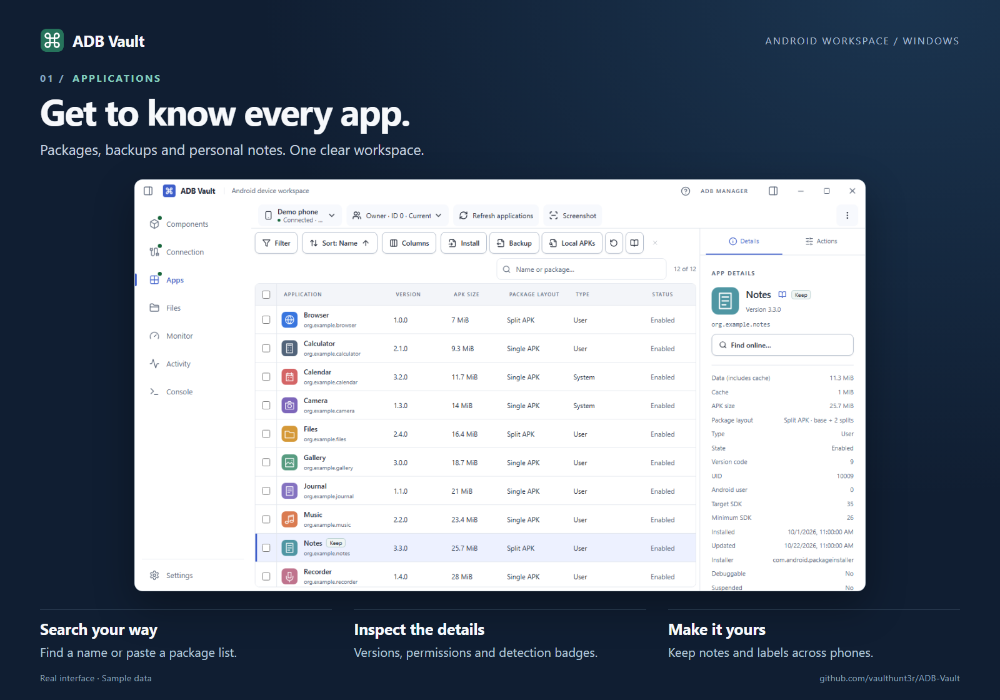
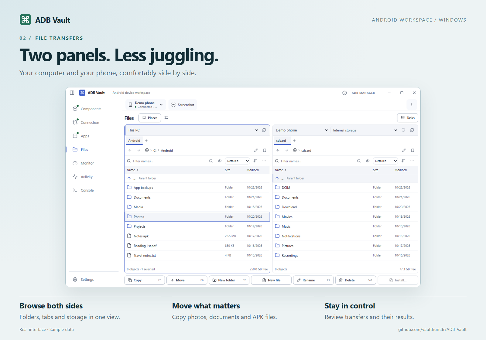
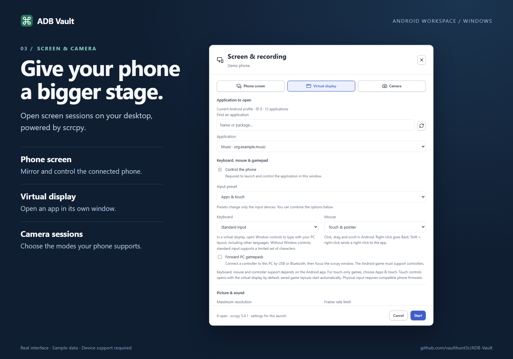

# ADB Vault

An Android device workspace for **Windows 10/11 x64**. Manage applications,
transfer files, inspect APKs and open phone, virtual-display and camera windows
from one desktop application.

**Browse installed apps without installing a companion APK on your phone.**
After you authorize ADB, ADB Vault runs its own collector on the device. It
reads app names, icons, package IDs and versions for the selected Android
profile in a single pass and streams the list to Windows. Reading the list
requires no root access or copies of the installed APKs on your PC.
[How the collector works](android-helper/README.md#session-and-protocol-1)

> [!IMPORTANT]
> **Public preview — testing on more devices is still needed.**
> Bugs are possible, and some features may fail or be unavailable. Testing has
> covered only a limited number of devices, not all Android versions, phone
> models or manufacturer firmware. Compatibility is not guaranteed.
>
> Keep backups before operations that modify apps or files. Please
> [report reproducible problems](https://github.com/vaulthunt3r/ADB-Vault/issues)
> with the app, Android and Windows versions and phone model, without personal data.

[Download Setup](https://github.com/vaulthunt3r/ADB-Vault/releases/download/v0.1.0/ADB-Vault-0.1.0-Windows-x64-Setup.exe) · [Download Portable](https://github.com/vaulthunt3r/ADB-Vault/releases/download/v0.1.0/ADB-Vault-0.1.0-Windows-x64-Portable.zip) · [Release notes and checksums](https://github.com/vaulthunt3r/ADB-Vault/releases/tag/v0.1.0)

[Explore ADB Vault in nine illustrated cards](docs/feature-guide/README.md)

## Download and install

Open [Releases](https://github.com/vaulthunt3r/ADB-Vault/releases) and choose a Windows download:

| Download | Use it for |
| --- | --- |
| `ADB-Vault-0.1.0-Windows-x64-Setup.exe` | Guided installation **or** portable extraction. Choose the destination, shortcuts and whether to launch afterwards. |
| `ADB-Vault-0.1.0-Windows-x64-Portable.zip` | Extract the entire archive into a writable folder and run `ADB Vault.exe`. Keep `portable-mode` beside it. |
| `SHA256SUMS.txt` | Verify downloaded files with PowerShell `Get-FileHash -Algorithm SHA256`. |

The first release is a **preview**. The Windows executables are not digitally
signed. Download only from this repository's Releases and compare checksums.
Java and APK inspection tools are included; no system Java installation is needed.

On first launch, open **Components** to locate existing ADB/Fastboot or download
them. Add **scrcpy** for screen, camera and audio features. Downloads require an
internet connection. USB drivers and Visual C++ are optional system components.

## What you can do

| Workspace | Highlights |
| --- | --- |
| Components | Locate or download tools; manage detection databases and updates. |
| Connection | Connect over USB or Wi-Fi, select a phone, open screen/camera sessions and device tools. |
| Apps | Browse and filter packages, paste package lists into search, inspect details and APKs, export/restore supported backups, disable/freeze apps, and keep personal notes across phones. |
| Files | Browse PC and phone in two panels, transfer files, search and preview supported media. |
| Monitor | View available process, memory, battery and network information. |
| Activity | Follow operations, their results and diagnostic details. |
| Console | Run ADB commands or Android shell commands on the selected device. |

Screen windows support keyboard/mouse input, native gamepad forwarding, optional
touch mappings, editable game presets and always-on-top. Availability depends on
Android, firmware and the application. Settings offers themes, density, corners,
workspace order, badge colors and configurable search websites.

The interface is **English only**. The optional **Quick tour** can be skipped and
replayed from the question-mark button in the title bar.

There’s a little Easter egg, too. Happy hunting 😉

## Connect a phone

1. Enable Developer options and USB debugging on your phone.
2. Connect by USB and accept the phone's authorization prompt.
3. Select the device in **Connection**. Use its Wi-Fi controls for a supported wireless connection.
4. Open the workspace you need. Select the Android user profile where applicable.

Local APK inspection works without a connected phone. Device operations require
an authorized ADB connection. Root is optional and needed only for certain
protected operations; ADB Vault does not root a phone.

## Documentation

- [User guide, updates and limitations](docs/USER-GUIDE.md)
- [Privacy and network behavior](docs/PRIVACY.md)
- [Build from source and run tests](docs/DEVELOPMENT.md)
- [Detection database scope](DETECTION.md) and [badge details](BADGES.md)
- [Validation and compatibility coverage](VERIFICATION.md)
- [Contributing](CONTRIBUTING.md), [Code of Conduct](CODE_OF_CONDUCT.md) and [security reports](SECURITY.md)
- [Release notes](docs/releases/v0.1.0.md)

## Licence

Original ADB Vault code is [MIT licensed](LICENSE). Bundled libraries, React Bits
adaptations, detection datasets and binary tools retain their **own licences**;
the entire distribution is not uniformly MIT. See [NOTICE.md](NOTICE.md).
Matching Java sources accompany each Windows release.

ADB Vault is an independent project, not affiliated with Android, Google,
Genymobile or the other projects credited in its notices.
