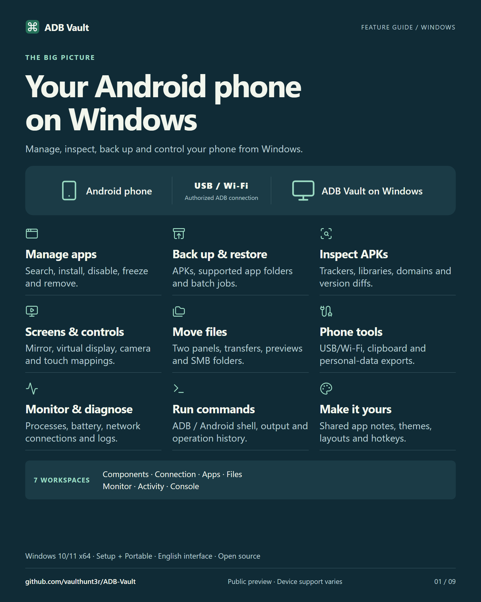
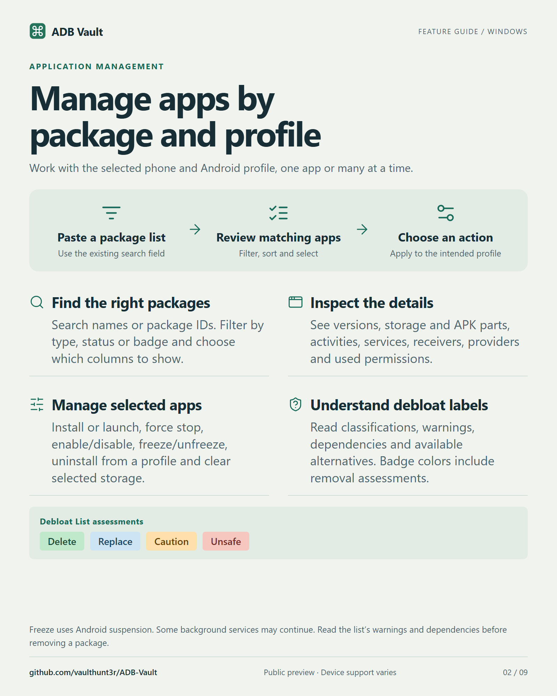
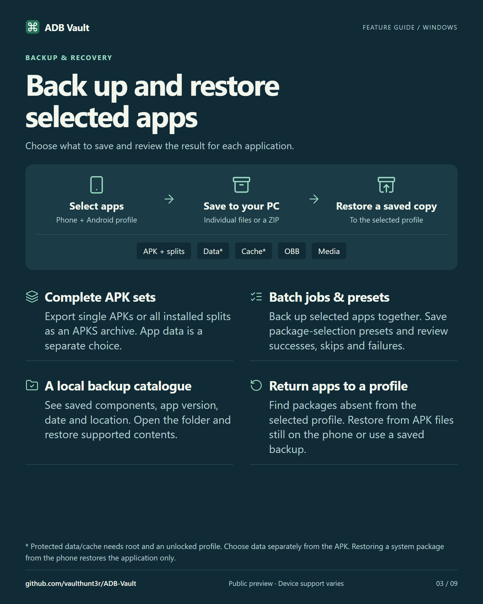
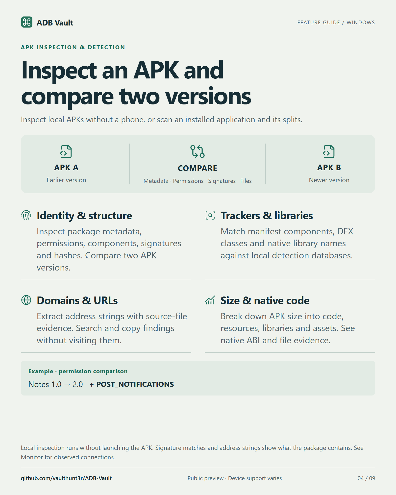
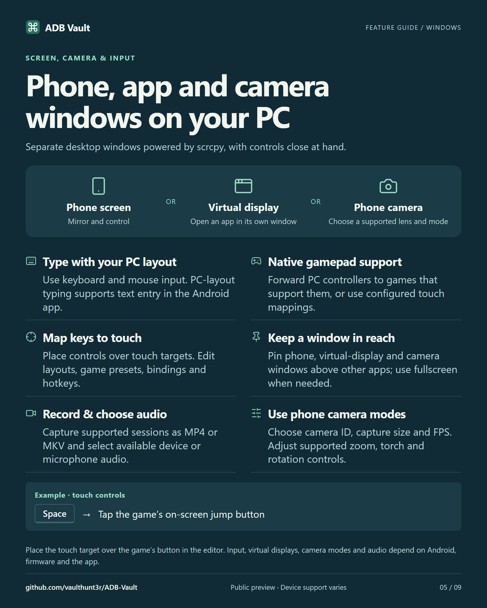
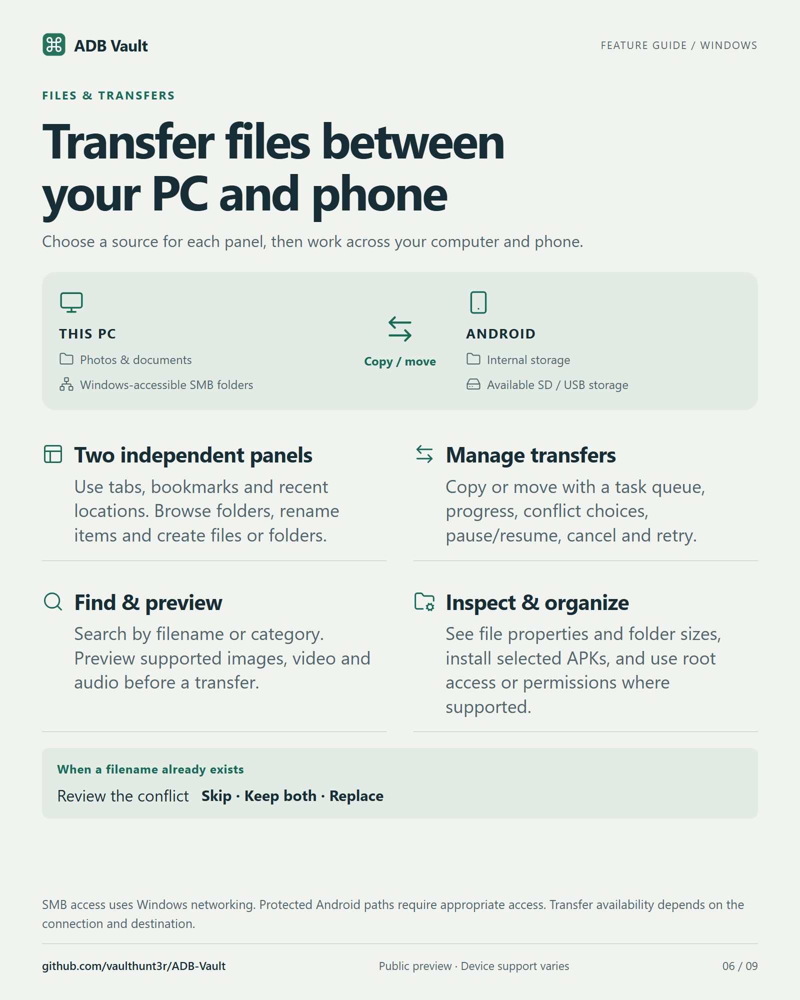
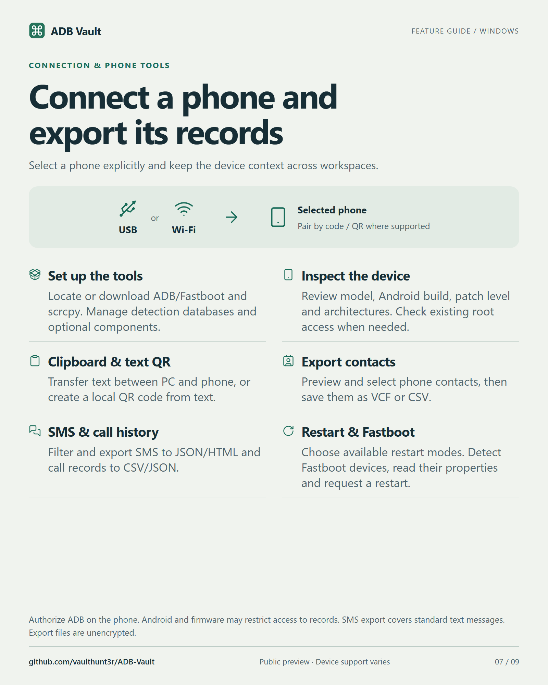
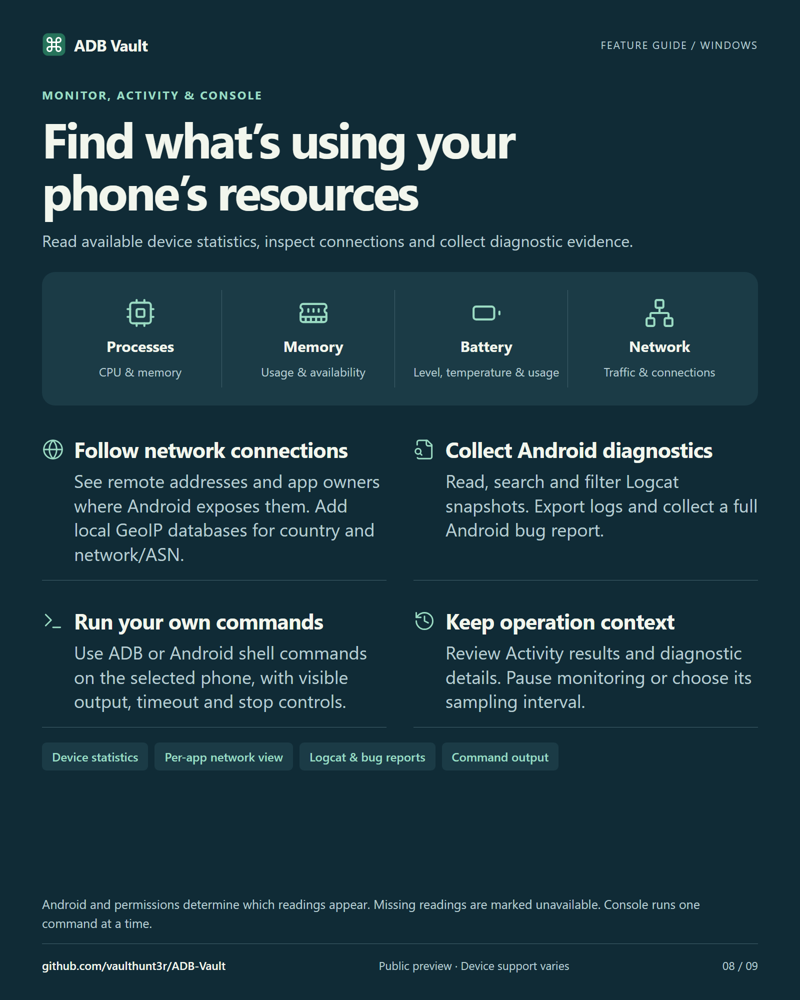
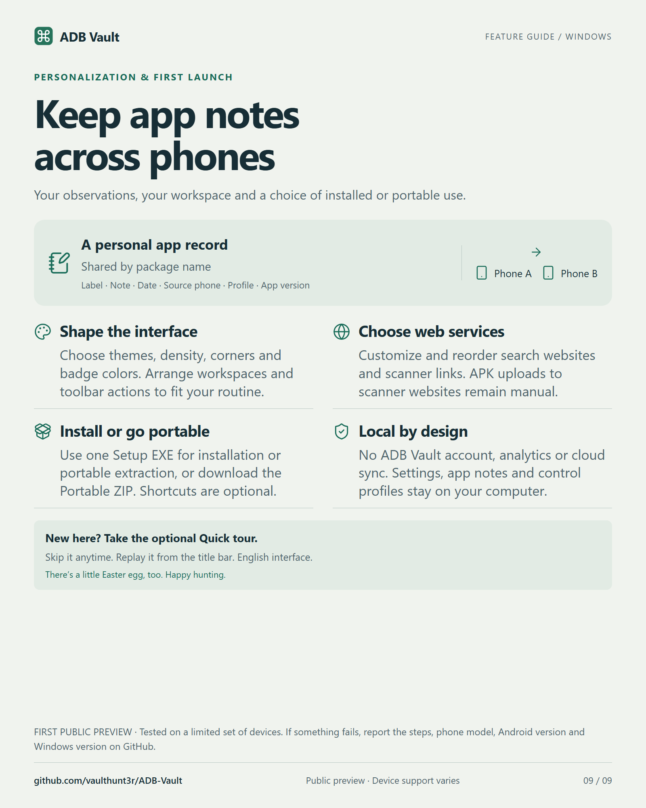

# Illustrated feature guide

Nine cards cover the Windows public preview. Select a card to see the full-size PNG. [Read the user guide](../USER-GUIDE.md) for instructions and device requirements.

## 1. Overview

The seven workspaces and the tasks you can do in each.

## 2. Apps and Android profiles

Search a package list, inspect components, review debloat labels and manage selected apps.

## 3. Backups and recovery

Choose backup contents, save installed splits and restore a package to a profile.

## 4. APK inspection

Compare versions and examine permissions, trackers, libraries, domains and file sizes.

## 5. Screen, camera and input

Mirror a phone, launch a virtual display, record a session and map keys to touch targets.

## 6. Files and transfers

Browse PC, Android and SMB folders and manage transfers between two panels.

## 7. Connection and phone tools

Connect over USB or Wi-Fi, use Fastboot, share clipboard text and export selected phone records.

## 8. Monitoring and diagnostics

Inspect resource usage, network connections, Android logs, shell output and operation results.

## 9. Personal records and setup

Use app notes across phones, customize the interface and choose installed or portable mode.

